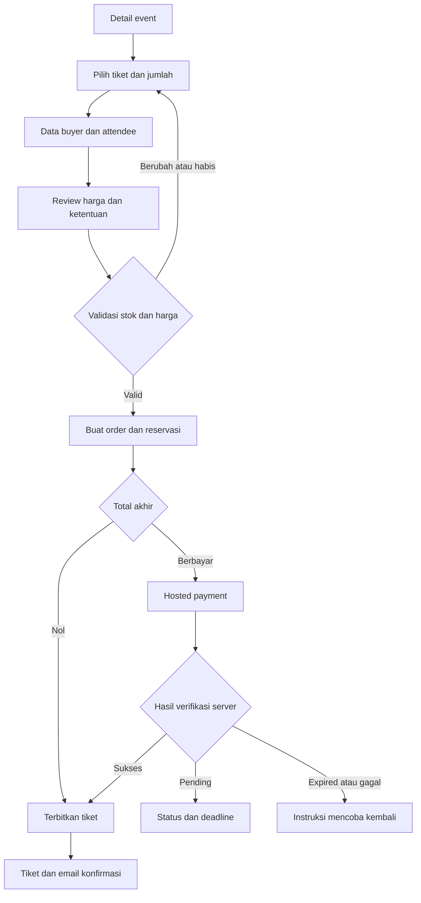
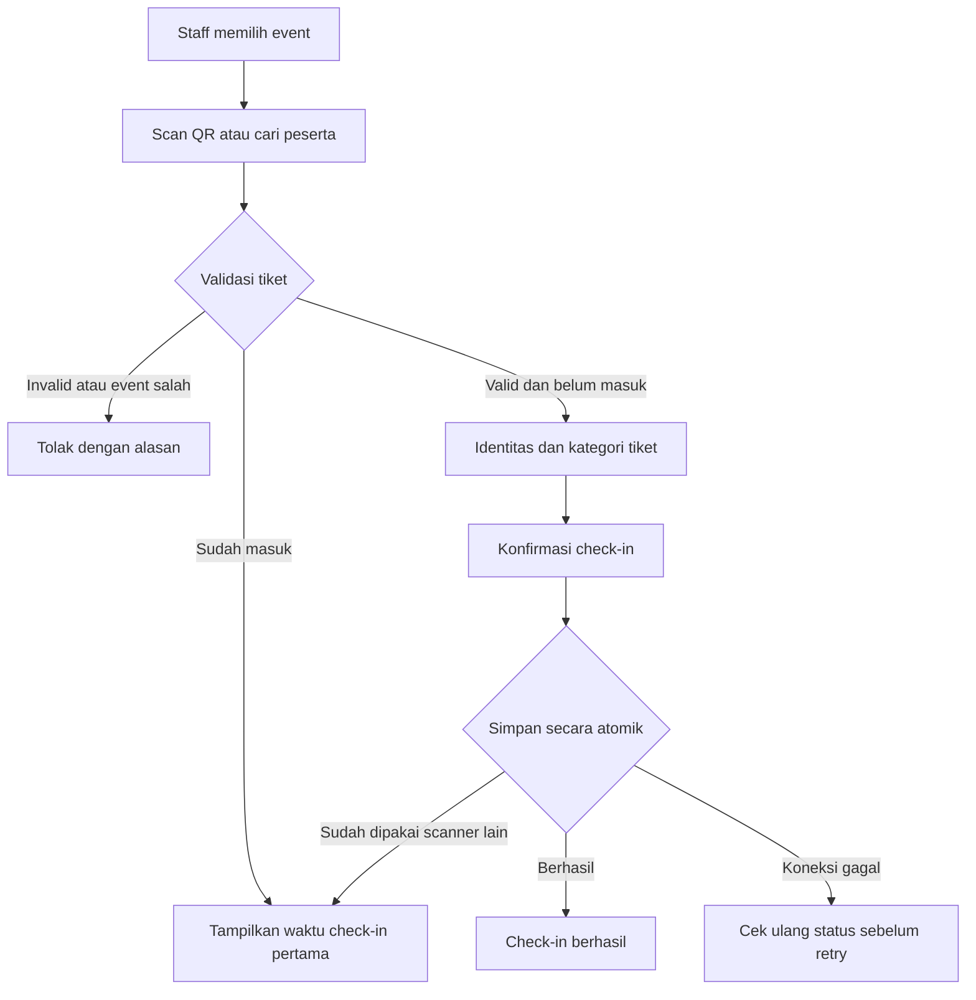
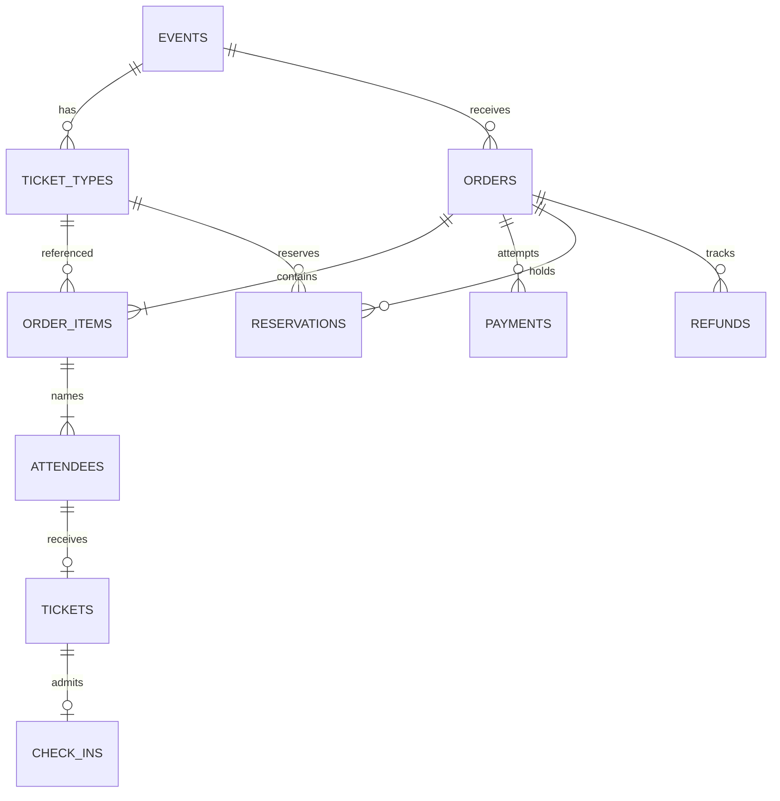
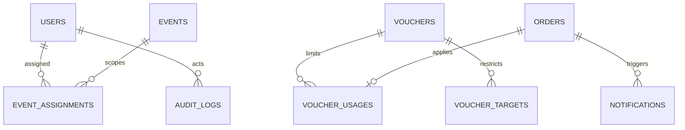

# Perencanaan Awal Lokarena

Aplikasi Ticketing Single Organizer

Versi 1.1 • 4 Oktober 2026 • Draft untuk review product, desain, engineering, QA, dan operasional

**Nama aplikasi:** Lokarena. Nama ini telah dipilih pengguna dan digunakan sebagai identitas produk pada dokumen dan contoh UI/UX. Nama badan penyelenggara tetap ditentukan terpisah.

Dokumen ini menurunkan PRD Lokarena sebelumnya menjadi acuan desain dan pengembangan untuk satu penyelenggara yang memiliki banyak event. Cakupannya adalah sitemap, user flow, spesifikasi layar awal, model data, kontrak API awal, backlog, acceptance criteria, dan rencana validasi. Ini merupakan rancangan awal, bukan desain visual final atau kontrak integrasi payment gateway yang telah disepakati.

## 1 Keputusan dasar dan batas MVP

Yang sudah disepakati adalah single organizer, dukungan banyak event, serta web responsif. Keputusan lain di bawah merupakan usulan kerja agar desain dapat dimulai; keputusan komersial dan operasional yang belum diketahui dicatat pada bagian 14.

| Area | Usulan baseline MVP | Implikasi |
|---|---|---|
| Peserta | Guest checkout tanpa kewajiban membuat akun | Akses order melalui sesi checkout atau verifikasi email |
| Pemilik order | Buyer sebagai pengelola order; setiap tiket punya attendee | Buyer dapat membeli untuk orang lain |
| Akses peserta | Magic link email; sesi terbatas dan token sekali pakai | Order ID saja tidak cukup untuk membuka tiket |
| Keranjang | Satu event per order; boleh beberapa jenis tiket | Pembayaran dan refund lebih sederhana |
| Mata uang | IDR, nominal integer rupiah | Tidak ada pembulatan pecahan rupiah |
| Pembayaran | Satu payment gateway melalui hosted checkout | Metode aktif mengikuti provider dan kesepakatan bisnis |
| Reservasi | Default 15 menit, dikonfigurasi; selaras expiry provider | Stok ditahan ketika order dibuat, bukan ketika halaman dibuka |
| Tiket gratis | Total akhir nol setelah diskon juga memakai alur gratis | Tidak membuat transaksi gateway |
| Check-in | Online, satu kali masuk per tiket | Koneksi venue menjadi prasyarat MVP |
| Refund | Full refund per order, diproses operasional melalui provider | Partial refund dan permintaan self-service masuk fase berikutnya |
| Registrasi | Nama dan email attendee; field tambahan terbatas pada template | Form builder penuh masuk fase berikutnya |
| Notifikasi | Email transaksi; retry dan resend | WhatsApp dan reminder otomatis ditunda |
| Laporan | CSV pada MVP, XLSX prioritas P1 | Angka finansial didefinisikan konsisten |
| Internal | Super Admin, Event Manager per event, Staff per event | Semua endpoint membatasi cakupan event |

Penyesuaian terhadap PRD: My Tickets pada MVP berarti daftar tiket setelah verifikasi email, bukan akun peserta dengan password. Refund penuh dan pembatalan event tetap masuk MVP sebagai fungsi operasional. Complimentary ticket, override check-in kedua, transfer tiket, reminder, dan custom form builder tidak termasuk baseline ini. Untuk event online, tautan akses hanya tampil kepada pemilik tiket valid setelah order terpenuhi.

## 2 Sitemap dan struktur navigasi

### 2.1 Public dan peserta

| Route | Halaman | Akses | Catatan |
|---|---|---|---|
| `/` | Beranda | Publik | Event unggulan dan upcoming |
| `/events` | Daftar event | Publik | Pencarian, kategori, kota, tanggal |
| `/events/:slug` | Detail event | Publik | Pilihan jenis tiket dan jumlah |
| `/checkout/:sessionId` | Data buyer dan attendee | Sesi checkout | Session bukan kredensial permanen |
| `/orders/:orderId/payment` | Instruksi pembayaran | Pemilik order | Countdown dan status server |
| `/orders/:orderId` | Status dan detail order | Pemilik order | Pending, processing, confirmed, expired, review |
| `/tickets/:ticketId` | E-ticket | Pemilik atau penerima sah | QR dan unduhan |
| `/my-tickets` | Akses tiket melalui email | Publik lalu terverifikasi | Respons generik saat meminta link |
| `/my-tickets/list` | Tiket milik email terverifikasi | Sesi peserta | Upcoming, past, cancelled |
| `/terms`, `/privacy`, `/help` | Ketentuan, privasi, bantuan | Publik | Kontak penyelenggara |

Navigasi utama: Beranda, Event, Tiket Saya, Bantuan. Halaman checkout mempertahankan logo, langkah proses, dan bantuan tanpa menu yang ramai. Filter URL dapat dibagikan. Refresh checkout tidak membuat order baru.

### 2.2 Organizer

| Route | Halaman atau subhalaman | Role |
|---|---|---|
| `/admin/login` | Login dan pemulihan akses | Internal |
| `/admin` | Ringkasan lintas event | Admin; manager hanya event yang ditugaskan |
| `/admin/events` | Daftar event | Admin, manager |
| `/admin/events/new` | Buat draft event | Admin, manager |
| `/admin/events/:id/overview` | Dashboard event | Admin, manager |
| `/admin/events/:id/edit` | Informasi dan publikasi | Admin, manager |
| `/admin/events/:id/ticket-types` | Harga, kuota, periode jual | Admin, manager |
| `/admin/events/:id/orders` | Order dan detail pembayaran | Admin, manager |
| `/admin/events/:id/attendees` | Peserta, filter, detail tiket | Admin, manager |
| `/admin/events/:id/vouchers` | Promo | Admin, manager |
| `/admin/events/:id/check-in` | Ringkasan check-in | Semua role yang ditugaskan |
| `/admin/events/:id/reports` | Laporan dan export | Admin, manager |
| `/admin/orders/:id` | Detail, resend, review pembayaran, refund | Admin; manager read-only finansial |
| `/admin/users` | User dan penugasan event | Admin |
| `/admin/audit-logs` | Audit log | Admin |
| `/admin/settings` | Organisasi, email, gateway, kebijakan | Admin |

Menu global: Dashboard, Events, Orders, Participants, Reports, Users, Settings. Detail event menggunakan tab untuk fungsi spesifik event. Staff diarahkan ke `/staff/events`, kemudian `/staff/events/:id/scan` atau `/staff/events/:id/search`; menu finansial tidak tampil.

## 3 User flow utama dan pengecualian

### 3.1 Pembelian tiket



1. Peserta memilih event yang published dan masih membuka penjualan. Event cancelled, sold out, atau sales ended mempunyai CTA nonaktif dan penjelasan.
2. Kuantitas divalidasi terhadap batas per order, kuota jenis tiket, kapasitas total event, dan periode jual. Stok tampilan bukan jaminan reservasi.
3. Buyer mengisi nama, email, nomor HP; setiap tiket memerlukan nama dan email attendee. Ada opsi menyalin data buyer ke attendee pertama.
4. Sistem memvalidasi voucher dan menampilkan subtotal, diskon, fee, total, serta kebijakan refund. Persetujuan ketentuan transaksi terpisah dari persetujuan marketing opsional.
5. Submit memakai idempotency key. Server menghitung ulang harga; bila berbeda dari quote yang dilihat, UI meminta review ulang sebelum membuat order.
6. Server menahan stok dan penggunaan voucher secara atomik. Setelah commit, server membuat pembayaran provider. Kegagalan provider menampilkan retry yang mengacu order sama, bukan membuat order baru.
7. Return URL menunjukkan status sementara. Tiket hanya diterbitkan setelah verifikasi server atas payment success. Buyer dapat menutup browser; proses tetap berjalan.
8. Buyer melihat tiket, mengunduh PDF, dan menerima email. Kegagalan email tidak membatalkan pembayaran atau tiket.

| Kondisi | Hasil bagi pengguna | Perilaku sistem |
|---|---|---|
| Dua pembeli mengejar stok terakhir | Salah satu menerima tiket habis | Hanya satu reservasi berhasil |
| Tombol checkout ditekan dua kali | Satu order | Respons sebelumnya dikembalikan untuk key dan payload sama |
| Voucher habis saat submit | Review harga kembali | Tidak menerima total tanpa diskon secara diam-diam |
| Browser kembali tanpa webhook | Pembayaran sedang diverifikasi | Rekonsiliasi server; tidak percaya query URL |
| Payment provider timeout | Status sedang dicek | Cari transaksi berdasarkan reference sebelum retry create |
| Reservasi habis | Order expired; stok tersedia kembali | Release stok dan voucher satu kali |
| Pembayaran sukses terlambat | Pembayaran diterima dan sedang ditinjau | Hold manual review; tidak otomatis mengambil stok yang telah dilepas |
| Email gagal | Tiket tetap dapat dibuka dari sesi aman | Queue retry, resend dibatasi |
| Total nol | Langsung confirmed | Issue tiket idempotent tanpa gateway |

### 3.2 Mengakses ulang tiket

Peserta membuka Tiket Saya, mengisi email, dan menerima respons generik. Jika email berhak mengakses tiket, sistem mengirim magic link dengan TTL usulan 15 menit, sekali pakai. Setelah ditebus, sistem membuat sesi peserta terbatas. Buyer melihat seluruh tiket order miliknya; attendee melihat tiket yang dikaitkan dengan emailnya, tanpa data buyer atau attendee lain. Penggantian email attendee melalui admin dicatat dan mencabut sesi atau tautan akses yang relevan.

Token akses peserta berbeda dari token QR. Magic link tidak menampilkan tiket sampai berhasil diverifikasi. Token kedaluwarsa menyediakan aksi minta ulang; order number dan email tanpa verifikasi tidak membuka detail order.

### 3.3 Membuat dan menerbitkan event

Manager membuat draft, mengisi jadwal dan timezone, memilih offline/online/hybrid, menambahkan venue atau akses online, membuat ticket types, lalu menjalankan checklist publikasi. Publish ditolak bila tanggal tidak valid, kapasitas tidak cukup, ticket type belum lengkap, atau kebijakan belum tersedia. Setelah publish, event muncul pada listing. Event yang sudah memiliki order tidak dapat dihapus; perubahan jadwal, venue, atau pembatalan memakai konfirmasi dan audit log, serta pemberitahuan kepada peserta terdampak.

Harga baru hanya berlaku bagi order baru. Kuota tidak dapat diturunkan di bawah tiket allocated dan reservasi aktif. Mengubah jadwal harus meninjau ulang periode penjualan. Completed dan ongoing diturunkan dari jadwal, bukan perubahan manual yang menghapus status published/cancelled.

### 3.4 Check-in



Scan merupakan validasi, bukan mutasi. Staff menekan konfirmasi setelah melihat nama peserta. Dua scanner yang bersamaan hanya menghasilkan satu check-in. Check-in manual menggunakan ticket ID yang dipilih dari pencarian, wajib alasan, dan memakai aturan yang sama. Bila jaringan putus setelah konfirmasi, UI menampilkan status belum pasti dan melakukan cek ulang; tidak menyatakan berhasil tanpa respons server. Re-entry dan override check-in kedua tidak tersedia pada MVP.

### 3.5 Refund dan pembatalan event

Admin memilih order confirmed yang memenuhi kebijakan, membaca jumlah dan tiket terdampak, lalu membuat refund request. Tiket ditangguhkan selama refund berjalan sehingga tidak bisa check-in. Operasional memproses dana di provider. Admin mencatat reference dan bukti keberhasilan yang diverifikasi melalui prosedur operasional atau integrasi yang tersedia. Status refunded hanya dipakai setelah pengembalian berhasil; jika refund gagal, tiket dapat aktif kembali sesuai status event. Semua perubahan dicatat.

Refund untuk tiket yang sudah digunakan memerlukan pemeriksaan khusus admin dan alasan. MVP tidak otomatis menjual kembali kuota refund; restock merupakan perubahan kuota eksplisit yang diaudit. Pembatalan event menghentikan penjualan, melepaskan pending reservation, menangguhkan seluruh tiket, mengirim pemberitahuan, dan membuat daftar refund. Membatalkan event tidak berarti dana telah dikembalikan.

## 4 Spesifikasi wireframe awal

Wireframe berikut adalah struktur konten dan interaksi untuk desain low fidelity. Urutan elemen mengikuti baca mobile; pada desktop ringkasan dapat berada pada kolom kanan. Setiap layar memiliki loading, empty, error, dan retry jika relevan. Tabel berikut menjadi checklist layar untuk tim UX.

| ID dan layar | Susunan konten utama | CTA dan validasi | State khusus |
|---|---|---|---|
| C01 Beranda | Header, hero, featured, upcoming cards, footer | Lihat event | Belum ada event published |
| C02 Listing | Judul, search, filter, hasil, pagination | Buka detail; reset filter | Tidak ada hasil; filter dipertahankan |
| C03 Detail event | Banner, judul, waktu/timezone, lokasi, deskripsi, agenda, tiket, ketentuan | Lanjut dengan pilihan tiket | Upcoming, sold out, ended, cancelled |
| C04 Registrasi | Stepper, buyer, attendee per tiket, ringkasan | Lanjut review | Field error inline; kembali tidak menghapus data |
| C05 Review checkout | Event, attendee ringkas, voucher, rincian harga, persetujuan | Buat order | Harga berubah; voucher invalid; stok habis |
| C06 Payment | Order number, total, deadline server, instruksi provider, bantuan | Bayar; cek status | Pending, timeout, expired; tidak reset timer saat refresh |
| C07 Order detail | Status, pembayaran, jumlah, tiket, bantuan | Buka tiket; resend | Paid processing; manual review; refunded |
| C08 E-ticket | Event, nama, kategori, QR besar, jadwal, lokasi atau akses online | Download PDF | QR tidak ditampilkan saat suspended/cancelled |
| C09 Akses tiket | Input email, instruksi, konfirmasi generik | Kirim tautan | Link expired; cooldown resend |
| C10 Tiket Saya | Tab upcoming/past, daftar tiket dan status | Buka tiket | Empty; sesi expired |
| A01 Dashboard | Filter periode/event, KPI, tren, daftar exception | Buka event atau order review | Data kosong; definisi metrik terlihat |
| A02 Events | Search, status, jadwal, tabel event | Buat; edit; lihat | Draft dan cancelled dibedakan |
| A03 Event editor | Informasi, jadwal, lokasi, gambar, kebijakan, preview | Save draft; publish | Unsaved changes; publish checklist |
| A04 Ticket types | Daftar, editor nama/harga/kuota/periode/batas | Save; hide | Kuota di bawah allocated ditolak |
| A05 Orders | Filter status, search, tanggal, tabel | Detail | Refund/pembayaran review terlihat |
| A06 Order detail | Buyer, items, payments, fulfillment, timeline | Resend; refund sesuai role | Late payment; notification failed |
| A07 Attendees | Filter tiket/check-in, search, tabel | Detail; export | Masking data sesuai role |
| A08 Vouchers | Daftar, jenis diskon, eligibility, limits, periode | Create; disable | Voucher aktif sedang direservasi |
| A09 Reports | Filter event/periode, ringkasan, breakdown | Generate CSV | Processing; export failed; expired link |
| A10 Users | User, role, penugasan event, status | Invite/create; deactivate | Tidak menghapus admin terakhir |
| A11 Audit | Filter actor, action, entity, waktu | Buka detail aman | Data sensitif disamarkan |
| A12 Settings | Profil organizer, konfigurasi, kebijakan | Save sesuai permission | Secret tidak ditampilkan penuh |
| S01 Event selection | Event ditugaskan, waktu, status, jumlah hadir | Mulai scan | Tidak ada assignment |
| S02 Scanner | Pilihan event, camera area, flash, status jaringan, hasil | Confirm; cari manual | Camera denied; invalid; already used |
| S03 Manual search | Search, hasil minimal, detail tiket, alasan | Confirm manual | Nama sama dibedakan ticket ID |

### 4.1 Detail struktur layar kritis

**C03 Detail event:** bagian atas berisi banner dan judul, lalu waktu dengan timezone dan venue. Deskripsi, agenda, speaker jika tersedia, serta kebijakan berada di badan halaman. Setiap ticket type menampilkan benefit, harga, status, dan kontrol jumlah. Bagian bawah mobile menampilkan jumlah tiket, total estimasi, serta CTA Lanjut; CTA tidak menutupi konten atau field.

**C04 Registrasi:** stepper Pilih tiket / Data peserta / Review / Bayar. Form buyer lebih dulu, diikuti kartu Attendee 1 hingga N yang dapat diringkas setelah valid. Email diberi penjelasan sebagai tujuan akses tiket. Ringkasan menunjukkan event, jenis tiket, jumlah, dan total estimasi. Error diarahkan ke field pertama yang bermasalah.

**C05 Checkout:** rincian biaya transparan sebelum submit. Voucher memiliki input dan tombol Terapkan, hasil diskon, serta aksi hapus. Checkbox ketentuan wajib; marketing terpisah dan default tidak tercentang. Tombol menunjukkan nominal final. Harga tersimpan sebagai snapshot ketika order dibuat.

**A06 Detail order:** header menampilkan order number dan status; bagian utama berisi buyer, attendee, items, rincian nominal, payment attempts, fulfillment, refund, dan timeline. Late payment muncul sebagai kasus review dengan amount, waktu pembayaran, deadline, serta alasan. Admin memilih refund atau fulfillment setelah memperoleh stok baru secara atomik dan mengecek event tetap aktif; manager tidak bisa menetapkan paid secara manual.

**S02 Scanner:** event aktif selalu tampak. Hasil valid berisi nama, kategori, ticket ID, dan tombol Konfirmasi. Hasil duplicate menampilkan waktu check-in pertama. Warna disertai teks dan ikon agar bukan satu-satunya pembeda. Setelah hasil ditutup, kamera siap memindai lagi; scan berulang pada frame yang sama tidak mengirim request tanpa batas.

### 4.2 Standar UX

Bahasa awal Indonesia. Waktu ditampilkan dalam timezone event; database menyimpan UTC dan nama timezone. Form mempunyai label, dukungan keyboard, error yang terbaca pembaca layar, dan fokus jelas. Target sentuh minimum usulan 44 px. Kamera harus memiliki fallback pencarian manual. Harga, fee, kebijakan refund, dan batas pembayaran tidak boleh tersembunyi. QR e-ticket bukan tautan publik ke data peserta.

## 5 Role dan permission

| Tindakan | Super Admin | Event Manager | Check-in Staff |
|---|---|---|---|
| Membuat event dan penugasan | Ya | Buat event; assignment awal otomatis | Tidak |
| Edit/publish/tiket/voucher | Semua event | Event ditugaskan | Tidak |
| Lihat peserta | Semua event | Event ditugaskan | Data minimal event ditugaskan |
| Lihat order dan laporan | Semua event | Event ditugaskan | Tidak |
| Export peserta/penjualan | Ya | Event ditugaskan | Tidak |
| Scan dan manual check-in | Ya | Event ditugaskan | Event ditugaskan |
| Refund dan late payment review | Ya | Read-only | Tidak |
| Cancel event | Ya | Tidak; ajukan operasional | Tidak |
| User, role, settings, audit global | Ya | Tidak | Tidak |

Authorization berlaku di server, tidak hanya menu. Staff tidak dapat membuka order finansial melalui URL atau API. Semua perubahan stok, harga, status event, refund, permission, dan manual check-in tercatat pada audit log. Akun nonaktif kehilangan sesi aktif. Admin internal memakai MFA sebagai baseline keamanan launch.

## 6 State dan aturan konsistensi

### 6.1 Pisahkan status

| Entitas | Status | Arti |
|---|---|---|
| Event publication | draft, published, cancelled, archived | Kontrol publikasi dan penjualan |
| Event waktu | upcoming, ongoing, completed | Turunan start/end, bukan mengganti publication |
| Order | pending_payment, processing, confirmed, expired, cancelled, manual_review, refund_pending, refunded | Kondisi komersial dan fulfillment |
| Payment attempt | created, pending, succeeded, failed, expired | Status provider yang dinormalisasi |
| Reservation | active, consumed, released | Kepemilikan kuota sementara |
| Ticket | valid, suspended, cancelled, refunded | Hak masuk; check-in dicatat terpisah |
| Refund | requested, processing, succeeded, failed | Proses pengembalian dana |
| Notification | queued, sent, failed | Status pengiriman, terpisah dari order |

UI "Pembayaran berhasil, tiket diproses" berarti payment succeeded dan order processing. Confirmed berarti seluruh tiket yang diwajibkan sudah ada. Free order confirmed tidak memiliki payment attempt; total nol merupakan bukti jalur gratis yang sah. Partially refunded ditunda sehingga tidak ada state tersebut pada MVP.

### 6.2 Transisi order

| Dari | Trigger | Ke | Efek |
|---|---|---|---|
| Baru | Create order berbayar | pending_payment | Reserve kuota dan voucher |
| Baru | Create order total nol | processing lalu confirmed | Consume kuota dan terbitkan N tiket |
| pending_payment | Payment sukses saat reserve active | processing lalu confirmed | Consume reserve dan issue idempotent |
| pending_payment | Deadline tercapai tanpa sukses terverifikasi | expired | Release reserve/voucher |
| pending_payment | Batal atau event cancelled | cancelled | Release; sukses berikutnya masuk review |
| expired/cancelled | Provider membuktikan sukses | manual_review | Dana tercatat; tidak otomatis issue |
| confirmed | Refund dimulai | refund_pending | Suspend seluruh tiket order |
| refund_pending | Refund sukses | refunded | Tiket refunded; ledger refund tercatat |
| refund_pending | Refund gagal | confirmed | Aktifkan tiket jika event tidak cancelled |
| manual_review | Admin memperoleh stok dan menyetujui fulfillment | processing lalu confirmed | Reserve baru atomik; consume; audit |
| manual_review | Admin memilih refund dan refund sukses | refund_pending lalu refunded | Tidak membuat tiket |

Status provider dan waktu pembayaran diverifikasi server. Race antara expiry worker dan webhook dikunci pada order/reservation yang sama: yang lebih dulu commit menentukan apakah reserve masih active. Sukses provider setelah release selalu masuk manual review, meskipun paid_at lebih awal. Tidak ada overwrite succeeded menjadi failed hanya karena webhook lama datang belakangan.

### 6.3 Inventory dan harga

Untuk setiap ticket type: `available = quota - allocated - active_reserved`. Allocated berarti tiket yang telah diterbitkan, termasuk tiket refunded yang belum direstock secara eksplisit. Kapasitas event juga mengecek jumlah seluruh allocated dan reserved lintas ticket type. Setiap update menggunakan transaksi/atomic condition. Expiry worker aman diulang; tidak release dua kali.

Harga rupiah dihitung server: eligible subtotal per item, alokasi diskon integer per item, subtotal setelah diskon, fee, total. Diskon persentase menggunakan pembulatan turun dalam rupiah, dibatasi maksimum diskon dan eligible subtotal. Fee ditentukan oleh kebijakan organizer yang disepakati; tidak mengasumsikan biaya provider otomatis dibebankan ke peserta. Total akhir tidak negatif. Snapshot menyimpan harga, diskon, fee, nama tiket, dan policy version.

Voucher satu per order; minimum belanja mengacu eligible subtotal sebelum fee. Limit penggunaan menghitung reserved usage dan committed usage agar checkout bersamaan tidak melampaui limit. Release mengikuti expiry/cancel; refund tidak mengembalikan hak penggunaan voucher pada baseline MVP. Batas per customer menggunakan email buyer yang dinormalisasi; guest checkout tidak dapat menjamin identitas unik, sehingga batas ini bukan perlindungan anti-abuse yang kuat.

## 7 Model data dan ERD awal

Buyer tidak harus menjadi User internal. Snapshot attendee dan harga menjaga order historis. Soft delete digunakan untuk konfigurasi yang pernah dipakai; transaksi tidak dihapus melalui UI.





| Entity | Field penting | Constraint dan catatan |
|---|---|---|
| Users | id, name, email, password_hash, role, active, mfa_config | Email normalized unique; internal saja |
| EventAssignments | user_id, event_id | Unique pasangan; semua manager/staff dibatasi |
| Events | id, slug, title, type, timezone, start_at, end_at, publication_status, capacity, venue, online_access_ref, policy_version | Slug unique; end > start; akses online bukan field public |
| TicketTypes | id, event_id, name, price_idr, quota, sales_start/end, min/max_per_order, visible | price >= 0; quota >= allocated + reserved |
| Orders | id, number, event_id, buyer_name/email/phone, subtotal, discount, fee, total, status, expires_at, policy_version | Number unique; total immutable setelah create |
| OrderItems | id, order_id, ticket_type_id, quantity, unit_price, discount_allocated, ticket_name_snapshot | Semua nominal integer; quantity positif |
| Attendees | id, order_item_id, slot_index, name, email, phone, extra_fields | Unique item + slot; count sesuai quantity |
| Reservations | id, order_id, ticket_type_id, quantity, status, expires_at | Transisi terkunci; konsumsi/release tepat satu kali |
| Tickets | id, attendee_id, public_code, qr_token_hash, status, issued_at | attendee unique; code unique; token unik |
| Payments | id, order_id, provider, merchant_reference, provider_reference, amount, currency, status, paid_at | Reference provider unique bila tersedia; amount = order total |
| WebhookEvents | provider, event_key, payload_digest, received_at, processed_at, result | Unique provider + event_key; payload sensitif diminimalkan |
| CheckIns | id, ticket_id, staff_id, checked_in_at, method, reason | ticket_id unique; method scan/manual |
| Vouchers | id, code, kind, value, max_discount, min_spend, start/end, usage_limit, per_email_limit, active | Code normalized unique; validasi periode |
| VoucherTargets | voucher_id, event_id, ticket_type_id nullable | Batasi eligibility; tiket harus milik event |
| VoucherUsages | id, voucher_id, order_id, buyer_email, discount, status | order unique; reserved/committed/released |
| Refunds | id, order_id, amount, status, reason, requested_by, provider_reference, evidence_ref, completed_at | MVP total penuh; bukti bukan sekadar input status |
| Notifications | id, order_id, recipient, kind, status, attempts, next_retry_at, dedupe_key | Dedupe key unique; retry tidak issue tiket lagi |
| AuditLogs | actor_id, action, entity_type/id, before/after_redacted, reason, created_at | Append-only; secret dan QR tidak dicatat |
| AccessTokens | id, token_hash, email, scope, expires_at, consumed_at | Sekali pakai; QR token terpisah |
| ExportJobs | id, requested_by, event_id, filters, status, file_ref, expires_at | Download memerlukan permission kembali |
| Outbox | id, topic, entity_id, dedupe_key, payload, processed_at | Disimpan bersama transaksi inti; untuk fulfillment/email |

QR berisi random opaque token, tanpa PII atau ID berurutan. Database menyimpan hash untuk validasi. Salinan token untuk menggambar ulang QR disimpan terenkripsi dengan akses terbatas atau di artifact e-ticket yang dilindungi; token mentah tidak masuk log. Issue ulang token mencabut token lama dan dicatat.

Index awal: event publication/start, ticket event, order event/status/date, buyer email, attendee email/name sesuai strategi search, reservation status/expiry, notification retry, payment reference, ticket hash, dan audit entity/date. Unique constraint menjaga idempotensi data; application check saja tidak cukup.

## 8 Spesifikasi API awal

Ini daftar endpoint dan kontrak domain untuk diskusi engineering. OpenAPI lengkap, provider mapping, dan kode error final diselesaikan setelah gateway dan arsitektur autentikasi dipilih. Prefix `/api/v1`; HTTPS; admin session dan peserta session dibedakan. Cookie session memerlukan CSRF protection untuk mutasi. List memakai pagination cursor dan limit maksimum; timestamp ISO 8601 UTC dengan timezone event sebagai field tersendiri.

### 8.1 Public dan peserta

| Method dan endpoint | Fungsi | Akses atau aturan |
|---|---|---|
| GET `/events` | Event published + filter | Tidak mengirim online access |
| GET `/events/{slug}` | Detail, ticket types, estimasi stock | Stock bukan reservasi |
| POST `/checkout/quotes` | Hitung harga server | items, voucher; rate limited |
| POST `/orders` | Create dan reserve | Idempotency-Key wajib; quote dan attendee |
| GET `/orders/{id}` | Status, items, tiket bila berhak | Session pemilik; ID bukan authorization |
| POST `/orders/{id}/payment-attempts` | Buat/resume hosted payment | Jangan buat attempt kedua bila pertama masih aktif |
| POST `/orders/{id}/cancel` | Batalkan pending order | Owner; race dengan payment terkunci |
| POST `/ticket-access/request` | Kirim magic link | Respons generik; rate limit email/IP |
| POST `/ticket-access/redeem` | Tukar token menjadi sesi | Once; TTL; token disamarkan |
| GET `/me/tickets` | Daftar tiket yang berhak | Participant session |
| GET `/tickets/{id}` | Detail e-ticket | Owner/attendee scope |
| GET `/tickets/{id}/download` | PDF dilindungi | Tidak cache publik; validasi scope |

### 8.2 Internal dan integrasi

| Method dan endpoint | Fungsi | Permission |
|---|---|---|
| POST `/admin/auth/login`, POST `/admin/auth/logout` | Sesi internal | MFA/lockout sesuai konfigurasi |
| GET/POST `/admin/events` | List/create | Admin/manager |
| PATCH `/admin/events/{id}` | Edit draft atau field diizinkan | Event scope; version check |
| POST `/admin/events/{id}/publish` | Publikasi | Checklist lengkap |
| POST `/admin/events/{id}/cancel` | Pembatalan operasional | Admin; alasan wajib |
| GET/POST `/admin/events/{id}/ticket-types` | List/create tiket | Event scope |
| PATCH `/admin/ticket-types/{id}` | Harga/kuota/periode | Inventory guard; version check |
| GET `/admin/orders`, GET `/admin/orders/{id}` | Monitoring | Event scope |
| POST `/admin/orders/{id}/resend` | Retry notifikasi | Rate limit dan audit |
| POST `/admin/orders/{id}/review-resolution` | Fulfill/refund late payment | Admin; stok/payment verification |
| POST `/admin/orders/{id}/refunds` | Mulai full refund | Admin; reason |
| POST `/admin/refunds/{id}/record-result` | Catat hasil operasional | Admin; reference dan bukti |
| GET `/admin/events/{id}/attendees` | Peserta dan filter | Mask field sesuai role |
| GET/POST `/admin/events/{id}/vouchers` | List/create | Event scope |
| PATCH `/admin/vouchers/{id}` | Disable/update aturan | Tidak mengubah snapshot order |
| POST `/staff/events/{id}/ticket-validations` | Scan tanpa mutasi | Token tidak di query URL/log |
| POST `/staff/events/{id}/check-ins` | Commit scan/manual | Atomic; Idempotency-Key |
| GET `/staff/events/{id}/attendees` | Manual search | Data minimal; rate limit |
| POST `/admin/events/{id}/exports` | Generate report | Scope dan filter; asynchronous |
| GET `/admin/exports/{id}` | Status/download | Permission dicek ulang |
| GET/POST `/admin/users`, PATCH `/admin/users/{id}` | Internal user dan assignment | Admin |
| GET `/admin/audit-logs` | Audit | Admin |
| PATCH `/admin/settings` | Konfigurasi organizer | Admin; secret terpisah |
| POST `/webhooks/payments/{provider}` | Payment event | Signature/provider verification, bukan user session |

### 8.3 Contoh kontrak create order

```json
{
  "event_id": "evt_01",
  "quote_id": "quo_01",
  "buyer": {"name": "Budi", "email": "budi@example.com", "phone": "+6281234567890"},
  "items": [{
    "ticket_type_id": "type_regular",
    "quantity": 2,
    "attendees": [
      {"name": "Budi", "email": "budi@example.com"},
      {"name": "Sari", "email": "sari@example.com"}
    ]
  }],
  "voucher_code": null,
  "terms_version": "terms_v1",
  "terms_accepted": true,
  "marketing_consent": false
}
```

Request header `Idempotency-Key` dibuat klien untuk satu submit, tidak diganti hanya karena retry. Server menyimpan key, hash payload, dan response; key sama dengan payload berbeda ditolak. Response create membentuk sesi pemilik order secara aman.

```json
{
  "data": {
    "id": "ord_01",
    "number": "ORD-20261004-000123",
    "status": "pending_payment",
    "amounts": {"currency": "IDR", "subtotal": 500000, "discount": 0, "fee": 0, "total": 500000},
    "expires_at": "2026-10-04T04:30:00Z",
    "payment_status": "not_started"
  },
  "request_id": "req_01"
}
```

Nilai contoh bukan transaksi aktual. Gateway URL dikembalikan endpoint payment-attempt; seluruh jumlah tetap dihitung backend. Code error standar: `VALIDATION_ERROR` 422, `PRICE_CHANGED` 409, `SOLD_OUT` 409, `ORDER_EXPIRED` 409, `ALREADY_CHECKED_IN` 409, `UNAUTHORIZED` 401, `FORBIDDEN` 403, `RATE_LIMITED` 429. Pemilik yang tidak berhak atas resource menerima 404 untuk mencegah enumerasi. Error envelope menyertakan code, message aman, field_errors bila ada, dan request_id.

### 8.4 Webhook dan proses background

Webhook memverifikasi signature serta merchant, provider reference, currency, dan amount terhadap order. Invalid event tidak mengubah data. Event valid disimpan/dideduplikasi lalu diproses idempotent; acknowledgement mengikuti kontrak provider setelah penerimaan durable. Repeated atau out-of-order event tidak menggandakan tiket maupun menurunkan status succeeded. Provider event ID digunakan bila tersedia; kunci alternatif ditentukan adapter provider secara eksplisit.

Worker expiry, fulfillment, email, export, dan reconciliation aman untuk retry. Outbox menghubungkan commit order/payment dengan pekerjaan background sehingga crash setelah pembayaran tercatat tidak kehilangan penerbitan tiket. Rekonsiliasi memeriksa payment pending/unknown melalui API provider dan menghasilkan exception queue, bukan tombol manual paid yang bebas. Backoff, dead-letter queue, dan alert digunakan setelah retry gagal berulang.

## 9 Backlog awal dan acceptance criteria

P0 berarti syarat launch baseline, P1 berarti dapat menyusul setelah alur inti stabil. Setiap baris dapat dipecah lagi menjadi design, backend, frontend, dan QA task. Sprint adalah urutan kerja; durasi belum menjadi komitmen karena kapasitas tim belum diketahui.

| ID | Sprint | Prioritas | User story | Acceptance criteria utama |
|---|---|---|---|---|
| US01 | 1 | P0 | Admin dapat login aman | Kredensial valid + MFA membuat sesi; akun nonaktif dan percobaan berlebih ditolak |
| US02 | 1 | P0 | Admin mengelola role dan assignment | Staff hanya akses event ditugaskan; API event lain ditolak; perubahan diaudit |
| US03 | 1 | P0 | Manager membuat draft event | Draft tidak tampil public; waktu dan timezone tersimpan benar |
| US04 | 1 | P0 | Manager publish event | Publish gagal bila data wajib/ticket invalid; berhasil tampil di listing |
| US05 | 2 | P0 | Manager mengatur ticket types | Harga non-negatif; periode valid; quota tidak di bawah allocation + reserve |
| US06 | 2 | P0 | Visitor mencari event | Hanya published; filter dan pagination konsisten; empty state jelas |
| US07 | 2 | P0 | Visitor melihat detail | Lokasi/waktu/benefit/harga/status terlihat; link online tidak bocor |
| US08 | 2 | P0 | Buyer memilih banyak tiket | Min/max dan event capacity divalidasi; N attendee wajib sesuai quantity |
| US09 | 2 | P0 | Buyer mengisi registrasi | Error per field; data tetap saat back; email/HP dinormalisasi |
| US10 | 3 | P0 | Buyer meninjau biaya | Server quote sesuai items; fee eksplisit; perubahan harga meminta review |
| US11 | 3 | P0 | Buyer membuat order sekali | Submit berulang key sama menghasilkan ID sama; payload berbeda ditolak |
| US12 | 3 | P0 | Sistem menahan stok | Request paralel tidak oversell ticket type maupun event capacity |
| US13 | 3 | P0 | Sistem melepas expired reserve | Deadline server memicu expiry; job diulang tidak menambah stok dua kali |
| US14 | 3 | P0 | Buyer menggunakan voucher | Eligibility/limit atomik; diskon bounded; expired reserve melepas usage |
| US15 | 4 | P0 | Buyer membayar hosted | Amount/currency/reference cocok; timeout tidak menciptakan charge ganda |
| US16 | 4 | P0 | Sistem memverifikasi sukses | Invalid signature/amount ditolak; return URL saja tidak issue tiket |
| US17 | 4 | P0 | Sistem tahan duplikasi webhook | Event berulang/out-of-order tidak issue ganda atau menurunkan status |
| US18 | 4 | P0 | Admin meninjau late payment | Setelah release, sukses masuk review; fulfillment butuh stock baru; refund diaudit |
| US19 | 4 | P0 | Buyer melihat status order | Refresh tidak reset expiry; processing dan manual review punya pesan berbeda |
| US20 | 5 | P0 | Sistem menerbitkan e-ticket | Confirmed hanya setelah N tiket ada; token unik; issue worker idempotent |
| US21 | 5 | P0 | Buyer memesan tiket gratis | Total nol skip provider; inventory/voucher tetap konsisten; N QR diterbitkan |
| US22 | 5 | P0 | Peserta membuka dan download tiket | Scope buyer/attendee benar; PDF terbaca; token QR tidak berisi PII |
| US23 | 5 | P0 | Peserta akses ulang melalui email | Token expired/used ditolak; respons request generik; rate limit berlaku |
| US24 | 5 | P0 | Sistem mengirim email | Email failure tidak mengubah order; retry/resend tidak issue ulang tiket |
| US25 | 6 | P0 | Staff scan tiket | Event salah/refunded/suspended ditolak; camera denied menawarkan manual |
| US26 | 6 | P0 | Staff check-in sekali | Dua staff bersamaan hanya satu CheckIn; yang lain melihat waktu pertama |
| US27 | 6 | P0 | Staff check-in manual | Search scoped; alasan wajib; constraint dan audit sama dengan scan |
| US28 | 7 | P0 | Manager mengelola peserta/order | Filter akurat; staff tidak melihat laporan finansial |
| US29 | 7 | P0 | Admin memproses full refund | Requested bukan refunded; sukses invalidasi tiket; failed mengikuti event status |
| US30 | 7 | P0 | Admin membatalkan event | Jual berhenti; pending reserve dilepas; tiket suspended; refund queue dan email tersedia |
| US31 | 7 | P0 | Manager memantau dan export | Definisi KPI cocok dengan dataset; CSV scoped; formula injection dinetralkan |
| US32 | 7 | P0 | Admin menelusuri audit | Actor/reason/time tersedia; secret dan token tidak tersimpan di log |
| US33 | 8 | P0 | Ops mendeteksi kegagalan | Webhook/fulfillment backlog dan inventory anomaly memberi alert; runbook dicoba |
| US34 | 8 | P0 | Ops memulihkan backup | Restore diuji; rekonsiliasi payment dilakukan sebelum membuka penjualan lagi |
| US35 | 8 | P0 | Peserta menggunakan mobile | Checkout/QR usable di target devices; error state dan keyboard diperiksa |
| US36 | Pasca MVP | P1 | Manager export XLSX | Angka cocok CSV; sheet formatted dan aman |
| US37 | Pasca MVP | P1 | Organizer mengirim reminder | Jadwal, timezone, opt-out, dedupe dan retry didefinisikan |
| US38 | Pasca MVP | P1 | Organizer punya form builder | Field schema versioned; data order historis tidak rusak |

### 9.1 Skenario QA kritis yang lebih rinci

**Stok terakhir:** Given kuota tersisa 1, When dua order berbeda dibuat secara paralel untuk satu tiket, Then hanya satu reserve aktif dan satu order sukses; order lain SOLD_OUT. Ulangi dengan dua ticket type yang berbagi kapasitas event terakhir.

**Webhook ganda:** Given payment reference sukses dan order berisi tiga attendee, When event sukses identik dikirim berulang dan worker fulfillment retry setelah crash, Then tetap ada tiga tiket, satu per attendee, dan satu pekerjaan email logis.

**Expiry race:** Given reserve mendekati deadline, When worker release dan sukses provider diproses bersamaan, Then hasil mengikuti transaksi yang commit lebih dulu; inventory tidak negatif dan order expired yang dibayar masuk manual review tanpa issue otomatis.

**Nominal palsu:** Given order total Rp500.000, When webhook sah secara format menyebut nominal berbeda, Then sistem tidak mengonfirmasi order dan membuat exception untuk review.

**Scan race:** Given tiket valid, When dua staff menekan konfirmasi bersamaan, Then hanya satu row CheckIns; hasil kedua ALREADY_CHECKED_IN. Retry dari staff pertama memakai idempotency key mengembalikan keberhasilan sebelumnya.

**Refund gagal:** Given order refund_pending dan event aktif, When hasil refund gagal diverifikasi, Then payment asli tetap succeeded, order kembali confirmed, tiket aktif; jika event cancelled tiket tetap suspended.

**Scope attendee:** Given buyer membeli tiga tiket untuk email berbeda, When salah satu attendee masuk melalui email sendiri, Then hanya tiket attendee tersebut terlihat dan detail buyer maupun attendee lain tidak tersedia.

## 10 Arsitektur awal dan tanggung jawab komponen

Gunakan modular monolith sebagai bentuk awal: public/participant web, organizer web, dan staff web berbagi backend dengan modul Identity, Events, Inventory, Pricing, Orders, Payments, Ticketing, CheckIn, Notifications, Reporting, dan Audit. Relational database memegang state dan constraint; queue/worker menjalankan pekerjaan yang dapat retry; object storage menyimpan banner, PDF, dan export dengan akses privat sesuai kebutuhan.

Payment adapter menormalisasi create, query status, webhook verification, expiry, dan refund result. Email adapter menangani send dan delivery failure. Tidak perlu memilih bahasa/framework dalam dokumen product ini; pilihan implementasi mengikuti kemampuan tim dan hasil spike integrasi. Cache tidak menjadi sumber kebenaran stok atau pembayaran.

Lingkungan development, staging, production dipisahkan, termasuk gateway sandbox, secret, email, storage, dan database. Perubahan schema diuji sebelum deploy. Transaksi order dan inventory menjadi batas atomik; network call provider dilakukan di luar lock database dengan recovery reference yang stabil.

## 11 Reporting dan non functional requirements

### 11.1 Definisi metrik

| Metrik | Definisi baseline |
|---|---|
| Tiket issued | Jumlah tiket diterbitkan; cancelled/refunded dilaporkan terpisah |
| Tiket aktif | Tiket valid, termasuk yang sudah check-in; exclude suspended/refunded/cancelled |
| Gross ticket sales | Nilai subtotal tiket dari order berbayar sukses, sebelum diskon dan fee |
| Collected amount | Jumlah pembayaran succeeded unik, termasuk dana yang masih direview |
| Discount | Total diskon order confirmed; free/100% discount dilaporkan terpisah |
| Refund amount | Pengembalian succeeded, bukan requested |
| Net collected | Collected amount dikurangi refund succeeded; belum dikurangi biaya provider |
| Pending payment | Order pending dan belum expired |
| Attendance rate | Tiket valid yang check-in dibagi tiket valid event; penyebut dinyatakan |
| Payment success rate | Attempt succeeded / attempt terminal; pending dikecualikan |

UI tidak menyebut net collected sebagai keuntungan atau settlement bank. Provider fee dan payout reconciliation dapat ditambahkan ketika sumber datanya tersedia. Semua laporan menyebut timezone, filter periode, dan basis waktu transaksi; refund ditampilkan berdasarkan waktu refund untuk laporan cash movement.

### 11.2 Target validasi awal

Angka berikut adalah target uji yang perlu disesuaikan terhadap ukuran event; bukan klaim kapasitas yang sudah teruji.

| Area | Target awal | Cara validasi |
|---|---|---|
| Mobile public | LCP p75 <= 3 detik pada profil mobile disepakati | Uji browser pada staging lalu telemetry |
| API umum | p95 <= 1 detik, exclude network provider | Load test dataset representatif |
| Validation/check-in | p95 <= 2 detik end to end pada koneksi venue target | Uji scanner concurrent |
| Ticket fulfillment | p95 <= 60 detik setelah success tercatat | Queue metrics; email latency terpisah |
| Availability | Target 99,5% per bulan untuk layanan inti | Synthetic monitoring; scope downtime dinyatakan |
| Backup | Usulan RPO <= 1 jam, RTO <= 4 jam | Restore drill; biaya disetujui sebelum launch |
| Load baseline | Usulan 100 checkout concurrent dan 10 scanner | Uji oversell, latency dan queue; revisi menurut traffic |
| Security | RBAC, MFA internal, token aman, rate limit, redacted log | Negative tests dan review konfigurasi |

Privasi: minimalkan data attendee, akses berbasis peran, marketing consent terpisah, proses permintaan akses/hapus, dan retensi yang disepakati organizer. Dokumen ini tidak menetapkan jangka retensi legal; validasi kebijakan dan kebutuhan transaksi dilakukan sebelum launch. Export dan PDF privat memakai tautan berumur terbatas; download dicek ulang. Backup dan secret dienkripsi serta akses dibatasi.

## 12 Rencana kerja dan dependensi

| Tahap | Output | Ketergantungan dan exit criteria |
|---|---|---|
| Discovery dan keputusan MVP | Scope, kebijakan fee/refund, volume, access rules | Bagian 14 punya owner dan keputusan |
| Desain awal | Sitemap final, low fidelity, prototype checkout/check-in | Semua happy path dan error penting tercakup |
| Validasi UX | Catatan uji buyer, manager, staff | Pengguna dapat bayar dan check-in tanpa arahan kritis |
| Spike engineering | Gateway sandbox, expiry/late payment, QR/camera, inventory race | Risiko integrasi dibuktikan dengan eksperimen |
| Desain teknis | Schema migration, OpenAPI, adapter mapping, observability | Engineer dan QA menyetujui domain transitions |
| Sprint 1–2 | Foundation, event dan registrasi | Role scope dan event publish teruji |
| Sprint 3–5 | Inventory, checkout, payment, e-ticket | Recovery, duplicate dan expiry konsisten |
| Sprint 6–7 | Check-in, operasi dan laporan | Refund/cancellation dan laporan sesuai |
| Sprint 8 | UAT, load/security checks, restore, pilot | Release gate terpenuhi |

Jika sprint berdurasi dua minggu, delapan sprint adalah 16 minggu pengerjaan, belum termasuk discovery atau dependensi eksternal. Itu ilustrasi, bukan estimasi final. Estimasi tim baru dibuat setelah prototype, gateway spike, jumlah developer, dan cakupan kebijakan disepakati.

Peran minimum yang perlu ditanggung tim: product owner untuk keputusan bisnis, UX untuk prototype, engineering untuk API/web/integrasi, QA untuk skenario concurrency dan transaksi, serta operations untuk refund dan dukungan event. Satu orang dapat memegang beberapa peran; tidak diasumsikan jumlah personel tertentu.

## 13 Risiko dan release gate

| Risiko | Pencegahan | Penanggung jawab fungsi |
|---|---|---|
| Oversell | Atomic reserve; event capacity guard; concurrency tests | Engineering |
| Dana masuk tanpa tiket | Outbox, retry fulfillment, reconciliation, exception queue | Engineering dan Ops |
| Pembayaran setelah expiry | Deadline selaras provider; manual review dan refund SOP | Product dan Ops |
| QR dibagikan | Token tidak dapat ditebak, satu check-in atomik, identitas terlihat | Engineering dan Staff |
| Jaringan venue buruk | Uji venue; koneksi cadangan; SOP status belum pasti | Ops |
| Kebocoran data export | Scope, signed links, retention, audit dan CSV escaping | Engineering |
| Pembatalan mendadak | Stop sales, suspend ticket, communication dan refund queue | Organizer |
| Scope berkembang | P0/P1 jelas; perubahan scope memperbarui desain dan backlog | Product owner |

Launch membutuhkan: end-to-end paid/free flow, validasi pembayaran, stok terakhir dan scan bersamaan, refund dan cancellation, permission negatif, email failure recovery, browser/mobile QA, backup restore, monitoring, serta UAT yang ditandatangani owner. Gateway production dan email domain siap; kebijakan fee/refund/privacy tersedia; tim support punya runbook.

Pilot dimulai dengan satu event dan kuota terbatas yang disepakati. Ops memantau exception payment, backlog ticket/email, dan check-in latency. Rollback tidak menghapus data transaksi; jika penjualan perlu dihentikan, existing payments tetap direkonsiliasi dan tiket existing tetap dapat dilayani sesuai keputusan operasional.

## 14 Keputusan yang perlu ditutup sebelum desain final

| Keputusan | Usulan sementara | Owner | Batas keputusan |
|---|---|---|---|
| Identitas produk dan organizer | Nama aplikasi Lokarena sudah dipilih; nama badan penyelenggara dan identitas visual final belum ditentukan | Product owner | Sebelum high fidelity |
| Besar event dan puncak transaksi | 100 checkout concurrent untuk baseline uji | Organizer + Engineering | Sebelum sizing |
| Gateway dan metode aktif | Satu gateway; hosted payment | Organizer + Engineering | Sebelum payment spike |
| Biaya checkout | Belum ditetapkan; tampil transparan | Organizer/Finance | Sebelum final pricing |
| Refund policy dan SLA | Full order; proses manual, target SLA ditentukan | Organizer/Finance | Sebelum desain checkout |
| Late payment policy | Review; refund jika tidak ada stock/event batal | Ops + Product | Sebelum payment implementation |
| Field registrasi wajib | Buyer nama/email/HP; attendee nama/email | Product owner | Sebelum form design |
| Kuota kapasitas event | Global capacity plus ticket quotas | Organizer | Sebelum event editor final |
| Akses webinar | Buyer/attendee valid saja; bukan publik | Organizer | Sebelum online event launch |
| Retensi data dan export | Belum ditentukan | Organizer + penanggung jawab privasi | Sebelum launch |
| Jam layanan dan pemilik exception | Ops khusus saat sales/venue | Organizer | Sebelum pilot |
| Tim, budget dan jadwal | Belum diketahui | Product owner | Sebelum commitment sprint |

## 15 Checklist handoff

Untuk UX: gunakan C01–C10, A01–A12, S01–S03 sebagai daftar layar; desain mobile checkout dan scanner terlebih dahulu, lalu dashboard. Setiap prototype mencakup sold out, price changed, payment pending/expired/review, email error, duplicate scan, dan camera denied.

Untuk engineering: finalisasi state transitions, schema/constraints, endpoint permission, idempotency, adapter gateway, queue recovery, dan event capacity sebelum mengerjakan UI transaksi. Tambahkan OpenAPI setelah kontrak provider dipilih.

Untuk QA: turunkan US01–US35 menjadi test cases berbasis acceptance criteria; prioritaskan kegagalan yang menghasilkan kehilangan dana, stok, tiket, atau akses data. Bedakan data sandbox dan production.

Untuk product dan operations: tutup keputusan bagian 14, tulis SOP late payment/refund/cancellation, dan tetapkan pemilik exception. Setelah itu dokumen ini dapat dibekukan sebagai baseline perencanaan v1.1 dan dipakai untuk estimasi serta kickoff.
